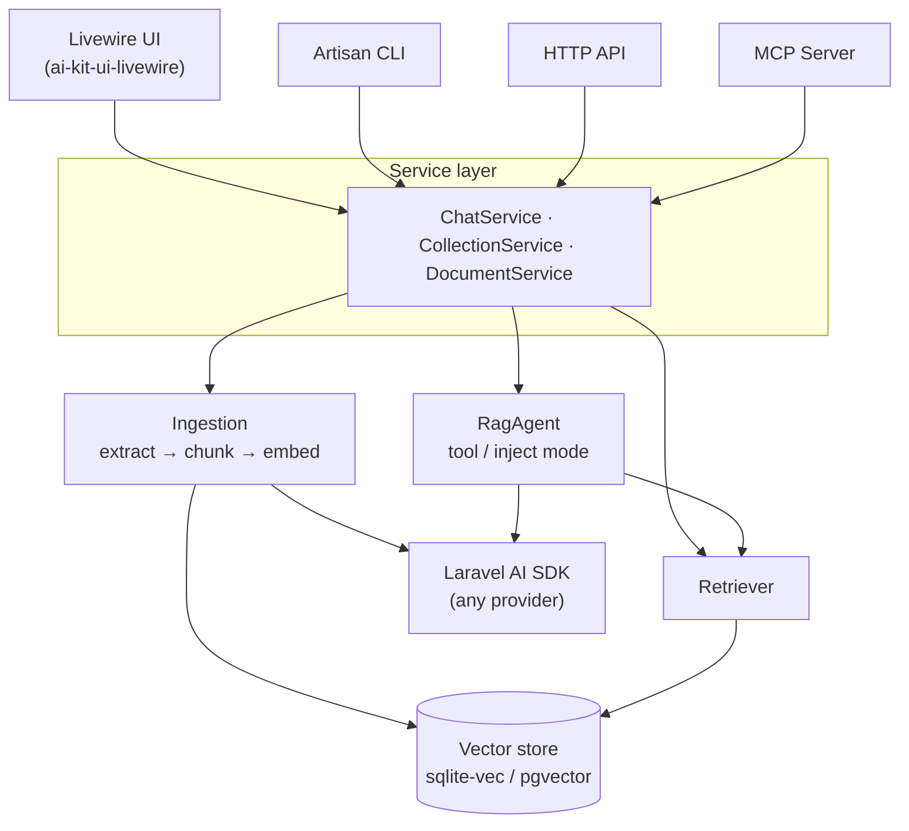

# ai-kit-core


**The engine of the ai-kit suite** — document ingestion, chunking, extraction, vector retrieval, and RAG agents for Laravel, built on the official [Laravel AI SDK](https://laravel.com/docs/ai).

> Guía de desarrollo (objetivos, stack, estructura, estado y relación con la suite): [DEVELOPMENT.md](DEVELOPMENT.md)

`composer require` → `php artisan ai-kit:install` → a grounded, cited RAG assistant over your own documents — with **no external vector database required**.

- **Two vector drivers** behind one contract: **SQLite** (zero-infra, default) and **pgvector** (production).
- **Two RAG modes** via one config flag: **tool** (agentic) and **inject** (classic).
- **Ingest** PDF, Word (.docx), Excel (.xlsx), HTML, Markdown, plain text, **and URLs**.
- **Provider-agnostic** — OpenAI, Anthropic, OpenRouter, Gemini, Groq, Mistral, … (anything the AI SDK supports), **plus local OpenAI-compatible servers** (Ollama, LM Studio, vLLM, llama.cpp).
- **Fully testable offline** — no API keys needed in CI.

## Why ai-kit?

Building a grounded, cited RAG chatbot over your own documents in Laravel means
wiring together a dozen moving parts: parsing PDFs/Word/Excel, chunking text,
generating embeddings, running a vector store, similarity search, prompt
orchestration, streaming, citations, conversation history, and cost tracking.

**ai-kit does all of that for you** — on the official Laravel AI SDK, with no
external vector database. `composer require` → `php artisan ai-kit:install` →
a working, source-cited assistant in under 30 minutes. Then expose it however
you like: a Livewire chat widget, an admin panel, a JSON API, a CLI, or an MCP
server for AI agents.

## Architecture



**One core, four faces.** Every surface calls the same service layer, so RAG
behaviour is identical whether a user chats in the browser, you script the CLI,
another service hits the API, or an AI agent connects over MCP.

## Requirements

- PHP **8.5+**
- Laravel **12 or 13**
- `laravel/ai` **^1.4**

## Install

```bash
composer require freddymx/ai-kit-core
php artisan ai-kit:install
```

The installer:
1. Publishes `config/ai-kit.php` + migrations (including the AI SDK's conversation tables).
2. Interactively asks for your **AI provider config** (chat + embeddings provider/model/key) and writes it to `.env`.
3. Scaffolds `App\Ai\SupportAgent` (extends `RagAgent`).
4. Runs migrations.
5. Optionally seeds a demo knowledge base.

Then set your keys (the installer adds the scaffold; fill in the value):

```dotenv
AI_KIT_CHAT_PROVIDER=openai
AI_KIT_CHAT_MODEL=gpt-5
AI_KIT_EMBED_PROVIDER=openai
AI_KIT_EMBED_MODEL=text-embedding-3-small
OPENAI_API_KEY=sk-...
```

## Migrating from `solution-forest/ai-kit-core`

Versions up to 0.2 were published as `solution-forest/ai-kit-core`. From 0.3 on,
the package is published as `freddymx/ai-kit-core`. The PHP namespace
`SolutionForest\AiKit\` is unchanged — no `use` statements or config class
references need updating.

```bash
composer remove solution-forest/ai-kit-core
composer require freddymx/ai-kit-core:^0.4
```

The old package remains on Packagist at v0.2.x for existing installations.

## Quick start

```php
use SolutionForest\AiKit\Models\Collection;
use SolutionForest\AiKit\Ingestion\IngestionService;
use SolutionForest\AiKit\Agents\RagAgent;

// 1. Create a knowledge base and ingest documents.
$kb = Collection::create(['name' => 'Handbook']);
app(IngestionService::class)->createFromPath($kb, storage_path('handbook.pdf'), sync: true);
app(IngestionService::class)->createFromUrl($kb, 'https://example.com/faq', sync: true);

// 2. Ask a question — grounded, cited, provider from config.
$response = (new RagAgent('handbook'))->prompt('What is the refund window?');
echo $response->text;
```

Or from the CLI:

```bash
php artisan ai-kit:ingest path/to/docs --collection=handbook   # file or directory
php artisan ai-kit:ingest-url https://example.com/faq --collection=handbook
php artisan ai-kit:demo                                         # seed 3 sample docs
```

## How ingestion works

```
createFromPath / createFromUrl
        │
        ▼
  ExtractText ──▶ ChunkDocument ──▶ EmbedChunks ──▶ vector index
 (pdf/docx/xlsx/    (recursive,      (AI SDK          (sqlite-vec
  html/md/txt)      sentence-aware)   embeddings)      or pgvector)
```

- **Synchronous** (`sync: true`) — runs inline; used by `ai-kit:demo` and CLI. No queue worker needed.
- **Queued** (default) — dispatches a chained `ExtractText → ChunkDocument → EmbedChunks` batch; document status moves `pending → processing → indexed` (or `failed`).

Every chunk stores its raw embedding **and** the embedding model name, so re-indexing with a different model is detectable and you can switch drivers without re-embedding blindly.

### Supported document types

| Type | Extractor | Notes |
|---|---|---|
| `.txt` `.md` `.csv` | `PlainTextExtractor` | |
| `.html` | `HtmlExtractor` | strips script/style/boilerplate |
| `.pdf` | `PdfExtractor` | via `smalot/pdfparser` |
| `.docx` | `WordExtractor` | zero-dependency (zipped XML) |
| `.xlsx` | `ExcelExtractor` | zero-dependency; extracts text cells |
| URL | fetch + `HtmlExtractor` | `createFromUrl` / `ai-kit:ingest-url` |

Legacy binary `.doc` / `.xls` are **not** supported.

## Two RAG modes

`config('ai-kit.mode')`:

- **`tool`** (default) — the agent gets a `SearchKnowledgeBase` tool and decides when/what to search (agentic RAG; supports multi-hop). Requires a model with reliable tool-calling.
- **`inject`** — no tool; `ContextInjector` retrieves and prepends context to the prompt before the model runs (classic RAG). Grounding never depends on the model choosing to search — safer with small models.

Both consume the same `Retriever` contract.

## Two vector drivers

`config('ai-kit.retrieval.driver')`:

- **`sqlite`** (default) — uses the sqlite-vec (`vec1`) extension when present, otherwise an **exact pure-PHP cosine scan** (correct everywhere, zero setup — ideal for demos and small/medium corpora). Optional extension path: `AI_KIT_SQLITE_VEC_PATH`.
- **`pgvector`** — a `vector` column indexed with HNSW/IVFFlat, searched with the `<=>` cosine operator. Scales to millions of chunks.

## Building agents

`RagAgent` reads config and wires the configured chat provider/model into every `prompt()` / `stream()`:

```php
use SolutionForest\AiKit\Agents\RagAgent;

(new RagAgent(collection: 'handbook'))
    ->forTenant('acme')            // optional tenant scope
    ->prompt('...');               // uses ai-kit.chat.provider + model
```

Customise instructions by extending it (the installer scaffolds this):

```php
namespace App\Ai;

use SolutionForest\AiKit\Agents\RagAgent;

final class SupportAgent extends RagAgent
{
    public function instructions(): \Stringable|string
    {
        return 'You are our support assistant. Always search first; answer only from the knowledge base; cite sources.';
    }
}
```

Point `AI_KIT_AGENT=App\Ai\SupportAgent` at it. The default instructions are strict-grounded (search-first, refuse-if-unsupported, cite by document title).

## Local language models

Set the provider sentinel to `local` to run chat **and/or** embeddings against
any OpenAI-compatible HTTP server: **Ollama, LM Studio, vLLM, llama.cpp**, etc.
ai-kit hands the SDK an on-demand provider (`Ai::build()`) named `ai_kit_local`
for its own agent/embedder, and also publishes the effective settings into
`config('ai-kit.*')` plus an `ai.providers.local` entry so **direct SDK calls**
(`Ai::text()`, `Ai::embeddings()`) and code reading config see the same server.
The SDK reads `models.text.default` / `models.embeddings.default` for calls that
don't pass a model explicitly.

| Variable | Default | Purpose |
|---|---|---|
| `AI_KIT_LOCAL_DRIVER` | `openai-compatible` | SDK driver: `openai-compatible` or `ollama` |
| `AI_KIT_LOCAL_URL` | `http://localhost:11434/v1` | Base URL of the local server |
| `AI_KIT_LOCAL_KEY` | _(none)_ | Optional API key / bearer token |
| `AI_KIT_LOCAL_CHAT_MODEL` | `llama3.2` | Model used for chat completions |
| `AI_KIT_LOCAL_EMBED_MODEL` | `nomic-embed-text` | Model used for embeddings |
| `AI_KIT_LOCAL_EMBED_DIMENSIONS` | `768` | Vector dimensions (keep in sync with your migrations) |

Ollama example:

```dotenv
AI_KIT_CHAT_PROVIDER=local
AI_KIT_EMBED_PROVIDER=local
AI_KIT_LOCAL_URL=http://localhost:11434/v1
AI_KIT_LOCAL_CHAT_MODEL=llama3.2
AI_KIT_LOCAL_EMBED_MODEL=nomic-embed-text
AI_KIT_LOCAL_EMBED_DIMENSIONS=768
```

Chat and embeddings resolve independently, so you can keep a hosted provider
for chat and use a local model only for embeddings (or vice versa):

```dotenv
AI_KIT_CHAT_PROVIDER=anthropic
AI_KIT_EMBED_PROVIDER=local
```

**Database overrides (the source of truth):** each of these values can also be
saved in the `ai_kit_settings` table from the **Filament plugin's AI settings
page**. A non-null database value always wins over `config/ai-kit.php` and
`.env`. On every request `AiProviderResolver::applyToConfig()` copies the
effective values into `config('ai-kit.chat.*')`, `config('ai-kit.embeddings.*')`
and `config('ai.providers.local')` (URL, key, text and embeddings models), so
the database wins even when the app uses the AI SDK directly. It also sets the
SDK's `ai.default` and `ai.default_for_embeddings`; set
`AI_KIT_APPLY_TO_SDK=false` to keep those two SDK-wide defaults untouched (the
`ai-kit.*` config and `ai.providers.local` are still published). The optional
`AI_KIT_SETTINGS` flag controls whether the Filament page is exposed.
`AiProviderResolver::reset()` (or the page's **Reset to .env**) deletes the row
and returns everything to `.env`.

> `php artisan config:cache` deliberately skips this DB → config step: booting
> providers during config caching would bake database values into the cached
> config file, where they would go stale after a settings change.

The local key is written to `ai.providers.local.key` in plaintext because the
SDK needs it — `AiProviderResolver::effective()` still masks it for UIs/logs.

The PHP classes still live in the `SolutionForest\AiKit\` namespace —
`SolutionForest\AiKit\Support\AiProviderResolver` and
`SolutionForest\AiKit\Support\AiSettings`. No `use` statements need changing.

## Conversation persistence & token usage

When a prompt runs **for an authenticated participant** (`->forUser($user)` / `->continue($id, $user)`), the AI SDK persists the exchange to `agent_conversations` / `agent_conversation_messages`, **including per-message token usage**. Aggregate it with `UsageStats`:

```php
use SolutionForest\AiKit\Support\UsageStats;

app(UsageStats::class)->totals(30);            // ['prompt'=>, 'completion'=>, 'total'=>, 'cost'=>, 'messages'=>]
app(UsageStats::class)->daily(14);             // per-day token series
app(UsageStats::class)->conversationTokens($id);
```

Delete a thread programmatically through `SolutionForest\AiKit\Services\ConversationService`: `app(ConversationService::class)->delete($id)` removes the conversation and its messages, and `deleteForParticipant($id, $user)` / `delete($id, $type, $key)` refuse to delete when the participant does not own it.

The SDK's conversation store has no delete method and its migration does not cascade on `conversation_id`, so the service provider registers an Eloquent `deleting` observer on `Conversation` that clears the messages for every delete path (including Filament).

## Upgrading from ai-kit 0.2 (AI SDK 0.x → 1.x)

ai-kit **0.3** is a breaking release across the whole suite: PHP **8.5+**,
`laravel/ai` **^1.4**, `laravel/mcp` **^1.0** (when MCP is enabled), Pest **5**,
sibling packages at `^0.3`, and `dev-main` aliased to `0.3.x-dev`. Upgrade
`ai-kit-core`, `ai-kit-ui-livewire` and `ai-kit-filament` together.

The Laravel AI SDK **1.0** changed how conversations are stored. If your app already
persists conversations, the SDK's own migration will not run again — publish and run
the backfill migration from the [AI SDK upgrade guide](https://github.com/laravel/ai/blob/1.x/UPGRADE.md)
before deploying. It rewrites `agent_conversation_messages` from the old
`tool_calls` / `tool_results` columns into a single `steps` column and replaces
`user_id` with `participant_type` / `participant_id`.

What ai-kit itself changed:

- `RagAgent::prompt()` / `stream()` accept the SDK's wider input types
  (`AgentInput|UserMessage|Decisions|string`).
- Conversations are scoped by participant (`participant_type` + `participant_id`)
  instead of `user_id`.
- Token usage is read from the SDK's `input_tokens` / `output_tokens` keys; rows
  written by the old SDK (`prompt_tokens` / `completion_tokens`) are still counted.
- `ConsistentConversationStore` now builds on the SDK's `steps` model: an
  unanswered tool call is no longer persisted, and already-stored history is
  repaired by the SDK on the next run.

The UI packages have their own short upgrade notes:
[ai-kit-ui-livewire](https://github.com/freddymx/ai-kit-ui-livewire#upgrading-from-ai-kit-02)
and [ai-kit-filament](https://github.com/freddymx/ai-kit-filament#upgrading-from-ai-kit-02).

## Multi-tenancy

Every table has a nullable `tenant_id`. Scope models + retrieval:

```php
use SolutionForest\AiKit\Facades\AiKit;

AiKit::withTenant('acme', fn () => (new RagAgent('handbook'))->prompt('...'));
```

Enable with `AI_KIT_TENANCY=true`. AI settings follow the same rule: `ai_kit_settings` holds one row per tenant, set the tenant (`AiKit::setTenant('acme')` / `withTenant()`) before saving — without one, writes are refused and nothing is published to config.

## Contracts (swap any layer)

| Contract | Default | Bind your own via the container |
|---|---|---|
| `Retriever` / `VectorIndex` | `SqliteVecRetriever` / `PgVectorRetriever` | custom store |
| `Embedder` | `AiSdkEmbedder` | e.g. a local embedder |
| `Chunker` | `RecursiveTextChunker` | custom splitting |
| `TextExtractor` | `ExtractorManager` | add extractors |

## Configuration reference

`config/ai-kit.php`: `mode`, `default_collection`, `agent` (class + instructions), `chat` (provider/model/fallback/streaming), `embeddings` (provider/model/dimensions/cache/timeout), `providers.local` (driver/url/key/models — see [Local language models](#local-language-models)), `chunking` (size/overlap), `retrieval` (driver/top_k/min_score/sqlite/pgvector), `ingestion` (queue/embed_batch), `tenancy`, `database` (connection/prefix), `features` (dashboard/token_usage/settings/apply_to_sdk), `pricing`. Every value has an `env()` override.

## Commands

| Command | Purpose |
|---|---|
| `ai-kit:install` | Publish config/migrations, configure AI providers, scaffold agent |
| `ai-kit:demo` | Seed a demo collection + 3 sample docs (sync) |
| `ai-kit:ingest {path} --collection=` | Ingest a file or directory |
| `ai-kit:ingest-url {url} --collection=` | Fetch + ingest a web page |

## Headless surfaces (CLI · HTTP API · MCP)

Everything the Filament panel does is reachable without Filament. All four
surfaces call the same service layer (`ChatService`, `CollectionService`,
`DocumentService`), so behaviour is identical everywhere.

### CLI

| Command | Purpose |
|---|---|
| `ai-kit:collection {list\|new\|show\|delete}` | Manage knowledge bases (`--json`) |
| `ai-kit:document {list\|chunks\|reindex\|delete}` | Manage documents (`--collection`, `--json`) |
| `ai-kit:search {query} --collection=` | Raw retrieval, no LLM (`--json`) |
| `ai-kit:chat {collection}` | Interactive grounded chat REPL |
| `ai-kit:conversation {list\|show}` | Conversation log + token usage (`--json`) |
| `ai-kit:stats` | Documents/chunks/tokens/cost (`--json`) |

### HTTP API (optional)

Enable with `AI_KIT_API=true`. Locked behind auth by default
(`config('ai-kit.api.middleware') = ['api','auth:sanctum']`); set your own guard,
or `['api']` for public. Prefix: `AI_KIT_API_PREFIX` (default `api/ai-kit`).

```
POST  /chat                          { message, collection?, conversation_id? } → answer + citations + usage
POST  /chat/stream                   SSE (token-by-token)
POST  /search                        { query, collection?, top? } → chunks
GET   /collections                   list
POST  /collections                   { name, slug?, description? }
GET   /collections/{slug}            + stats
GET   /collections/{slug}/documents  list
POST  /collections/{slug}/documents  { url | text | file, title?, sync? } → ingest
GET   /conversations                 list (+ token totals)
GET   /conversations/{id}            thread + per-message tokens
GET   /usage?days=30                 totals + daily series
```

### MCP server (optional)

Expose ai-kit to MCP clients (Claude Desktop, IDE agents). Requires
`composer require laravel/mcp`, then `AI_KIT_MCP=true`. Tools: `search_knowledge_base`,
`ask_knowledge_base`, `list_collections`, `ingest_url`. Serve over stdio:

```bash
php artisan mcp:start ai-kit
```

Set `AI_KIT_MCP_WEB=true` to also register an HTTP transport route
(`config('ai-kit.mcp.web_route')`, guarded by `mcp.web_middleware`).

### Examples

**HTTP API** (Bearer auth by default):

```bash
# Ask a question
curl -X POST https://your-app.test/api/ai-kit/chat \
  -H "Authorization: Bearer <token>" -H "Content-Type: application/json" \
  -d '{"message":"What is the refund window?","collection":"handbook"}'

# Raw search
curl -X POST https://your-app.test/api/ai-kit/search \
  -H "Authorization: Bearer <token>" -H "Content-Type: application/json" \
  -d '{"query":"refunds","collection":"handbook","top":5}'

# Ingest a URL
curl -X POST https://your-app.test/api/ai-kit/collections/handbook/documents \
  -H "Authorization: Bearer <token>" -H "Content-Type: application/json" \
  -d '{"url":"https://example.com/faq"}'
```

**MCP** — point a client (e.g. Claude Desktop) at the stdio server:

```json
{
  "mcpServers": {
    "ai-kit": {
      "command": "php",
      "args": ["artisan", "mcp:start", "ai-kit"],
      "cwd": "/path/to/your/laravel/app"
    }
  }
}
```

**Programmatic** (any surface, same result):

```php
use SolutionForest\AiKit\Services\ChatService;

$result = app(ChatService::class)->ask('What is the refund window?', 'handbook');
$result->answer;      // string
$result->citations;   // [{document_title, chunk_index, score, content}, ...]
$result->usage;       // {in, out, total}
```

## Testing

The suite runs **offline with no API keys** — LLM calls use the AI SDK's fakes, embeddings use a deterministic in-memory double.

```bash
composer install && vendor/bin/pest
```

## The ai-kit suite

**One core, four faces** — the Livewire UI, CLI, HTTP API, and MCP server all
call the same service layer (`ChatService`, `CollectionService`,
`DocumentService`), so behaviour is identical everywhere.

| Package | Purpose |
| --- | --- |
| **freddymx/ai-kit-core** (this) | Ingestion, retrieval, agents + CLI, HTTP API, MCP |
| [freddymx/ai-kit-ui-livewire](https://github.com/freddymx/ai-kit-ui-livewire) | Livewire 4 chat component |
| [freddymx/ai-kit-filament](https://github.com/freddymx/ai-kit-filament) | Filament v5 admin panel |

`ai-kit-ui-livewire` and `ai-kit-filament` are optional; core is fully usable headless.

## Author

Created and maintained by **Alfredo Pineda** (<freddy@canariasnetworks.com>).
Originally published under the [SolutionForest](https://www.solutionforest.com)
organization; from 0.3 on, published in the `freddymx` Packagist namespace.

## License

MIT © [SolutionForest](https://www.solutionforest.com), Alfredo Pineda
